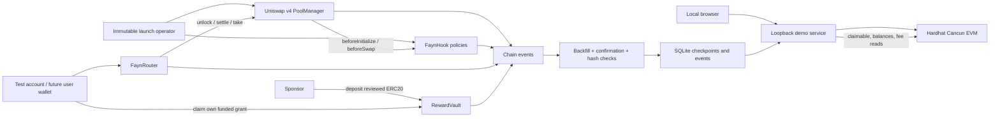

# Fayn architecture and trust model

## Vercel hosting update

The repository now supports two explicit frontend adapters. `web/client-api.js` selects using `runtime-config.js`: local source uses the actual EVM HTTP service, while `npm run build` writes static dist/ assets configured for the browser simulation. `vercel.json` deploys only that static directory. The browser adapter uses BigInt constant-product modeling and browser storage, never connects to a local RPC, and never signs blockchain transactions. Every hosted view labels the distinction. It has no contract addresses or onchain claim authority. All original contracts, ABIs, services, Solidity tooling and local transaction tests remain in the repository. See VERCEL.md for deployment and simulation limitations. Real public blockchain execution still requires deployed contracts and external-wallet integration.

The browser is a presentation layer. The local service uses an unlocked public Hardhat test signer. It refuses non-31337 chains, binds 127.0.0.1, rejects foreign origins and Host headers, and requires an unguessable session header on JSON mutations. This is a single-user local lab, never a public custodial backend. Actual external-wallet signing is a production readiness gap, not a simulated wallet connection presented as real.

FaynHook is deployed through CREATE2 with low fourteen address bits equal to 0x2080: beforeInitialize and beforeSwap only. It does not implement return deltas or levy a hook fee. Fee override flag is 0x400000; pool dynamic flag 0x800000. Fee units are millionths (3,000 = 0.3%). A single immutable operator allowlists standard ERC20 assets and configures future pools. Configured policies are immutable and cannot be paused. Only this operator may initialize a configured pool, preventing initial-price front-running between configure and initialize. Each policy requires ordered reviewed assets and tick spacing 60. Start cannot be in the past; duration is positive and at most 86,400 seconds; normal is 100–10,000; opening is between normal and 100,000.

For t ≤ start the disclosed fee is opening, though execution before start reverts. For t ≥ end it is normal. Between, `normal + ceil((opening-normal)*(end-t)/(end-start))`. No volatility oracle, secret classification, identity, router whitelist, or caller-supplied trader status is used. All compatible v4 routers see the same fee. Max-fee and quote-deadline safeguards belong to FaynRouter; third-party routers need their own quote protection.

FaynRouter exposes standard-token full-range (-887220, 887220) positions. Manager owns the underlying accounting slot under the router address and a salt derived from the wallet. The router's liquidity ledger permits only that wallet to withdraw. It never holds principal after settlement and has no upgrade or arbitrary-call path. A production NFT PositionManager is not integrated. Router supports negative exact-input and positive exact-output amounts in both directions, rejects partial fills, and enforces min output or max input, fee ceiling and deadline. Token debits and credits come from actual v4 BalanceDelta. SafeERC20 handles token calls. ReentrancyGuard protects entry points; unlockCallback accepts only PoolManager. Assets with transfer fees, rebases, callbacks, dishonest balanceOf or special transfer semantics are unsupported even if an operator mistakenly allowlists them. Review of the allowlist is a trust boundary.

RewardVault is separate from LP accounting. Grants are fully funded before credit; claim IDs include chainId, vault address, pool, epoch, beneficiary and token. The sponsor can fund grants, but cannot withdraw grants or change beneficiaries. No Merkle roots, publishers or proof generation are needed. The trust assumption is discretionary sponsor eligibility, never independent-human verification. Deployment prepares an immutable disabled vault by default. A local enabled vault demonstrates a fixed sponsor grant. Repeated grants in the same period add new funding and may be claimed after an earlier claim; the same funded amount cannot be claimed twice.

Indexing uses confirmed logs and durable SQLite WAL checkpoints. Event IDs include block hash, tx hash and log index. Restart resumes checkpoints, duplicate log IDs do not duplicate rows, hash mismatches roll back to a common ancestor, and batches check parent and log hashes before atomic commit. RPC errors retry with exponential backoff. Local confirmation depth is one; testnet needs 12 or more according to chosen risk tolerance. Onchain reads remain authoritative for transactions and claimability. Token decimals are read per token; amounts use BigInt/ethers parseUnits, not floating-point arithmetic. Initial-price input in the demo uses Number to derive sqrtPriceX96 and is explicitly an approximate test setup; production price initialization requires audited integer encoding.

No USD values are used. No price feed or oracle manipulation surface is introduced. The simulator uses synthetic quote units. There is no governance token, external analytics dataset, identity badge, audit claim, or live risk classifier.

## Architectural decisions

The repository was empty. Solidity 0.8.26, v4-core 1.0.2, OpenZeppelin 5.4.0, ethers 6.15.0 and Hardhat 2.26.3 are exactly pinned and lockfile-resolved. The local runtime is Node 24.19.0. Foundry was unavailable, so actual EVM integration and seeded deterministic property tests use Node's test runner and Hardhat Cancun. A dependency-light native-module frontend and single Node service replace suggested Next.js/PostgreSQL: there is no server-rendering need or multi-user deployment in this release. SQLite provides transactional durable event storage. The official v4 package supplies the canonical PoolManager artifact; custom contracts compile from source. No production AMM math was invented.

Implementation milestones: architecture and immutable fee contract; actual EVM settlement and rewards; indexed browser workflows; integration tests and synthetic economics; unsigned deployment preparation and documented gaps. Test outcomes are recorded separately and never inferred from source presence.
